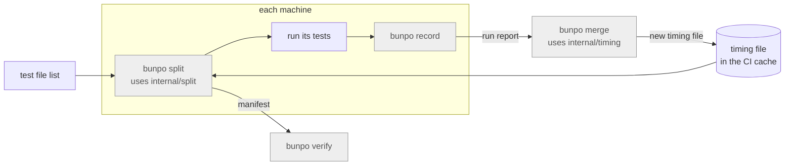
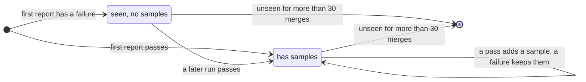

# The Bunpō book

This book describes the code as it is today. [PROJECT.md](../PROJECT.md) holds
the plan and the specification. Update the book whenever a change alters
behavior, architecture, setup or operation.

## Status

The engine is built. The commands that use it are not.

- `internal/split` builds canonical test lists, splits them and computes the
  digest.
- `internal/timing` reads and writes the timing file, takes medians, merges
  run reports and prunes stale tests.
- `cmd/bunpo` prints a placeholder message and exits with status 2. The
  `split`, `plan`, `record`, `merge` and `verify` commands, JUnit reading,
  manifests and the `verify` check do not exist yet.

## How it fits in CI

Grey boxes are not built yet. The engine behind `split` and `merge` is.



## Development setup

Install Go 1.21 or later. The `toolchain` line in `go.mod` (currently
`go1.27.4`) makes Go download the exact version on first use. Staticcheck and
`govulncheck` are `tool` directives in `go.mod`, so there is nothing else to
install.

```sh
gofmt -l .                     # must print nothing
go mod tidy -diff              # must print nothing
go vet ./...
go tool staticcheck ./...
go test -race ./...
go tool govulncheck ./...
go build -o bin/bunpo ./cmd/bunpo
```

Fuzzing and the benchmark run only when you ask for them:

```sh
go test -run '^$' -fuzz FuzzDecode -fuzztime 30s ./internal/timing
go test -run '^$' -bench BenchmarkSplit ./internal/split
```

CI (`.github/workflows/ci.yml`) runs on every push to `shrek` and on every
pull request. The lint job runs `gofmt`, `go mod tidy -diff`, vet, Staticcheck
and `govulncheck` on Linux. The test job builds and tests on Linux, macOS and
Windows. Windows skips the race detector because its runner has no cgo.

## Architecture

```text
cmd/bunpo/          placeholder entry point
internal/split/
├── inventory.go    canonical identifiers
└── split.go        dealing, plan, digest, warnings
internal/timing/
├── timing.go       file format, validation, median
└── merge.go        run reports, pruning
```

Neither package reads files, the environment or the clock. Every platform
gets the same answer, and the tests call each function directly. The future
commands in `cmd/bunpo` will read files, pick the path style from the
operating system and print results.

`split` imports `timing` for `Median` and `MaxDurationMS`. `timing` imports
nothing from Bunpō.

## Canonical test lists

`split.NewInventory(raw, style)` turns raw identifiers into an `Inventory`.
`Split` accepts only an `Inventory`, so it never sees unchecked input.

For each raw identifier, in order:

1. Reject it if it is empty, is not valid UTF-8, or contains a NUL, a
   carriage return or a newline.
2. With `POSIX`, reject any backslash. A backslash is a legal character in a
   POSIX file name, and reading it as a separator could merge two different
   files. With `Windows`, turn every `\` into `/`.
3. Reject a path that starts with `/`.
4. Split on `/`, drop empty and `.` components, and reject `..`.
5. With `Windows`, reject a first component that is a drive such as `C:`.
   This check comes after step 4 because `./C:/a.py` only shows its drive
   once the `.` is gone.
6. If an earlier spelling produced the same identifier, fail and name both.
   Skip an exact repeat of the same spelling.

`NewInventory` then sorts the identifiers by bytes, which gives the same order
on every platform and in every locale. More than 200,000 distinct identifiers
(`MaxTests`) is an error.

It does not fold case or normalize Unicode, so `Tests/a.py` and `tests/a.py`
stay two identifiers.

## The split

`split.Split(inv, durations, machines)` returns a `Plan`:

```text
split(inventory, durations, machines)
  for each test
    effective = its recorded duration, zero included
                or FillMS when it has none
  sort tests by effective duration, longest first
    equal durations keep byte order of path
  for each test in that order
    target = the machine with the least load
             on equal load, the one with fewer tests
             then the lower index
    give the test to target
  list each machine's tests in byte order
  digest = SHA-256 of the version, the machine count,
           and every path with its effective duration
```

`FillMS` is the median of the known durations of tests in the inventory.
`Split` ignores durations for tests outside it. With no known durations at
all, `FillMS` is 0, and the fewer-tests rule deals the tests out evenly.

The test count also protects suites with very fast files. Without it, every
file recorded at 0 ms would land on machine 0, because that machine's load
never rises above the others.

PROJECT.md's worked example has files of 9, 7, 6, 5, 4 and 3 minutes on two
machines. The split gives 9 + 5 + 3 to one and 7 + 6 + 4 to the other, 17
minutes each.

Schedulers call this method longest processing time first. Its largest load
is at most four thirds of the best possible split of the same durations.

| Field or method | Meaning |
| --- | --- |
| `Tests`, `Durations` | The canonical list and each test's effective duration, by index |
| `Shards`, `Loads` | Each machine's tests and predicted total |
| `Unknown`, `FillMS` | How many tests had no recorded duration, and the value they got |
| `Digest` | See below |
| `TotalMS()`, `LargestMS()` | Sum of all loads; the longest single test |
| `Dominant()` | One test is longer than the average load, so no split can balance |
| `EmptyShards()` | Machines with no tests |

### The digest

The digest is SHA-256 over these bytes:

```text
bunpo split <AlgorithmVersion>\n
machines <machine count>\n
<path>\x00<effective ms>\n        one line per test, in byte order
```

Equal digests mean equal splits. Two timing files that differ but give the
same effective durations produce the same digest, and that is right, because
the split is the same. `AlgorithmVersion` is 1. Raise it with any change that
could alter a split, so machines on different versions disagree loudly
instead of silently.

## The timing file

`timing.Encode` writes versioned JSON and `timing.Decode` reads it:

```json
{"version":1,"run":2,"tests":{"a.py":{"samples":[5,7],"last_seen":2},"b.py":{"samples":[],"last_seen":1}}}
```

- `run` counts merges.
- `samples` holds up to five recent durations in milliseconds, oldest first.
  It stays empty for a test that has been seen but has never fully passed.
- `last_seen` is the `run` of the last merge that saw the test.

`Encode` writes map keys in sorted order, so one file always gives the same
bytes. `Decode` reads the version first, so a file from a newer release fails
with its version number. It then rejects:

- unknown members, duplicate keys and invalid UTF-8
- more than five samples, or a sample outside 0 to 30 days
- a negative `run`, or a `last_seen` outside 0 to `run`
- input over 64 MiB

`Encode` runs the same checks before writing.

`File.Durations()` returns each test's median. It leaves out tests without
samples, so the split treats them as unknown.

### The median

`timing.Median` returns the middle value. For an even count it averages the
two middle values and rounds half up, with integers only: `[10, 21]` gives 16.
That is the median a spreadsheet gives, so a user can check a prediction by
hand.

### Merging

`timing.Merge(base, reports)` folds one CI run into the timing file. Each
`Report` holds one machine's observations, keyed by identifier. An
`Observation` says whether every case in the file passed (`Timed`) and how
long it took (`MS`).

A test moves through these states:



`Merge` refuses to run when:

- the base file is invalid
- there are no reports, because merging nothing would age every test without
  seeing any
- a test appears in two reports. It ran on two machines, so the split
  overlapped, and keeping either time would make the result depend on report
  order.
- a timed duration falls outside 0 to 30 days

Otherwise it adds one to `run`, marks every reported test as seen, appends
the timed samples and drops tests left behind. It never modifies `base`, and
the order of the reports does not change the result.

## Limits

| Constant | Value | Applies to |
| --- | --- | --- |
| `split.MaxTests` | 200,000 distinct tests | the inventory |
| `split.MaxMachines` | 256 | the split |
| `timing.MaxDurationMS` | 30 days | split durations, samples, reports |
| `timing.MaxSamples` | 5 per test | the timing file |
| `timing.PruneAfterRuns` | 30 merges | merging |
| `timing.MaxFileBytes` | 64 MiB | the timing file |

200,000 durations at the 30-day cap still sum to less than the `int64` limit,
so load totals cannot overflow.

## Tests

Table tests cover the inventory rules, the split cases (the worked example,
ties, an empty list, one test, more machines than tests, missing timings,
zero durations), the median, decoding, merging and the digest.

A property test generates 2,000 random suites with repeats, ties, zeros and
missing timings. It checks that every input test lands on exactly one machine,
that recorded durations reach the plan unchanged, that loads add up, and that
shuffling the input changes nothing.

An exhaustive search finds the best split for 500 small random cases. The
test fails if the split's largest load ever exceeds four thirds of it.

Two tests pin exact bytes: the timing file's JSON and the digest input. If
either fails, the format changed, and the change needs a new version number.

`FuzzDecode` feeds `timing.Decode` random input. `BenchmarkSplit` splits
50,000 tests across 256 machines in about 50 ms, against a budget of one
second.
