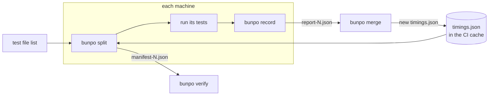
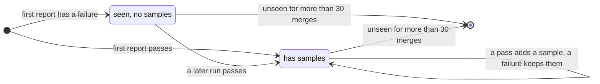

# The Bunpō book

This book describes the code as it is today. [PROJECT.md](../PROJECT.md) holds
the plan and the specification. Update the book whenever a change alters
behavior, architecture, setup or operation.

## Status

The command-line tool works: `split`, `plan`, `record`, `merge` and `verify`.
Release binaries, the GitHub Action and the runner guides do not exist yet.

## How it fits in CI



One run, on eight machines, looks like this:

```bash
# On machine N, with timings.json restored into .bunpo/
set -euo pipefail
find tests -name 'test_*.py' | bunpo split --index "$N" --total 8 > mine.txt

# One path per array item, so spaces and glob characters stay literal.
mine=()
while IFS= read -r path; do mine+=("$path"); done < mine.txt

# Given no files, most runners run the whole suite, so an empty share must
# skip the test command.
if [ "${#mine[@]}" -gt 0 ]; then
  pytest -o junit_family=xunit1 --junitxml=junit.xml -- "${mine[@]}"
  bunpo record --index "$N" junit.xml
else
  bunpo record --index "$N"
fi
# Upload .bunpo/ as an artifact.

# In a final job, with every machine's .bunpo/ downloaded into one empty folder
find tests -name 'test_*.py' | bunpo verify
bunpo merge   # on the main branch only; then save .bunpo/timings.json
```

The loop works in the bash 3.2 that macOS ships, which has no `mapfile`.

## Development setup

Install Go 1.21 or later. The `toolchain` line in `go.mod` (currently
`go1.27.4`) makes Go download the exact version on first use. Staticcheck and
`govulncheck` are `tool` directives in `go.mod`, so there is nothing else to
install.

```sh
gofmt -l .                     # must print nothing
go mod tidy -diff              # must print nothing
go vet ./...
go tool staticcheck ./...
go test -race ./...
go tool govulncheck ./...
go build -o bin/bunpo ./cmd/bunpo
```

Fuzzing and the benchmark run only when you ask for them:

```sh
go test -run '^$' -fuzz FuzzDecode -fuzztime 30s ./internal/timing
go test -run '^$' -fuzz FuzzRead -fuzztime 30s ./internal/junit
go test -run '^$' -bench BenchmarkSplit ./internal/split
```

The golden JUnit reports in `internal/junit/testdata/` come from the real
runners. To regenerate them after changing a sample suite or a pinned version,
run the script, refresh the expected totals, and review the diff:

```sh
internal/junit/testdata/generate.sh   # needs python3, node and ruby
go test ./internal/junit -update
```

The script runs every suite from `/tmp/bunpo-fixtures`, so absolute paths in
the reports never contain a home directory, and it scrubs host names and
time zones. `.gitattributes` forces LF line endings, because golden files are
compared byte for byte.

CI (`.github/workflows/ci.yml`) runs on every push to `shrek` and on every
pull request. The lint job runs `gofmt`, `go mod tidy -diff`, vet, Staticcheck
and `govulncheck` on Linux. The test job builds and tests on Linux, macOS and
Windows. Windows skips the race detector because its runner has no cgo.
Actions are pinned to commit SHAs, with the release named in a comment; bump
the SHA and the comment together. Each job saves its Go build and module
caches per commit and restores the newest one, so a run only rebuilds what
changed. The lint job also caches Staticcheck's results, which live outside
the Go build cache.

## Architecture

```text
cmd/bunpo/          the commands: flags, files, messages, exit codes
internal/split/     canonical identifiers, dealing, plan, digest
internal/timing/    timing file, median, merging, pruning
internal/junit/     reading JUnit XML and the two-column format
internal/manifest/  manifest, plan and run report files; the verify check
internal/jsonfile/  the strict versioned-JSON reader every file uses
```

Only `cmd/bunpo` touches files, standard input and the operating system. The
packages under `internal/` are plain computations on bytes and values, so
every platform gets the same answer and the tests call them directly.

Imports flow one way:

```text
cmd/bunpo  ──▶ junit, manifest, split, timing
manifest   ──▶ split, timing, jsonfile
junit      ──▶ timing
split      ──▶ timing
timing     ──▶ jsonfile
```

## The commands

Every file lives in one directory, `.bunpo/` unless `--dir` says otherwise.
Commands open it as an `os.Root`, so no name inside it can escape through
`..` or a symlink.

| File | Written by | Read by |
| --- | --- | --- |
| `timings.json` | `merge` | `split`, `plan`, `merge` |
| `manifest-<index>.json` | `split` | `record`, `verify` |
| `report-<index>.json` | `record` | `merge` |
| `plan.json` | `plan` | `split --plan` |

Standard output carries only test lists. Messages go to standard error. Exit
status is 0 on success, 1 when a check fails, and 2 for bad usage or input.

Messages go through one `console` (`cmd/bunpo/console.go`):

- **In GitHub Actions** (`GITHUB_ACTIONS=true`), warnings, errors and the
  verify result become `::warning::`, `::error::` and `::notice::` workflow
  commands, so GitHub shows them on the run summary and the pull request.
  Newlines and percent signs are escaped so a multi-line message stays whole.
- **In a terminal**, the `warning:`, `error:` and `assignment verified:`
  labels are bold honey, rose and mint. Only the label is colored, so the
  message keeps the terminal's own text color. Each color has at least 3:1
  contrast on white and 4.5:1 on a dark background. Truecolor is used when
  `COLORTERM` says so, and a 256-color fallback otherwise.
- **Anywhere else** the output is plain: when `NO_COLOR` is set, when
  `TERM=dumb`, when standard error is a file or a pipe, and on the old
  Windows console, which prints escape codes as text.

Every file is written to a temporary name and renamed into place, so a
failed write leaves the previous file intact. Every member of every format
is required: a missing `index` would otherwise read as machine 0.

- **`split --index N --total M`** reads the test list from standard input,
  one path per line, LF or CRLF. On Windows it reads `\` as a separator. It
  splits with `timings.json` when there is one and prints machine N's share.
  Only once the whole list is written does it write `manifest-N.json`, so a
  list that never reached the runner leaves no manifest for `verify` to
  accept. It also deletes any `report-N.json` an earlier run left behind.
  The summary gives the range and average of predicted loads and the longest
  file, and warns about a dominant file and empty shards.
- **`plan --total M`** splits once for every machine and writes `plan.json`.
  **`split --index N --plan`** then takes machine N's share from the plan
  instead of standard input. Every manifest carries the plan's digest, so
  `verify` works the same either way.
- **`record --index N REPORT...`** reads machine N's test reports, see below,
  and writes `report-N.json`. It needs this machine's manifest. With no
  reports it writes an empty run report, but only when the share was empty.
- **`merge`** reads every `report-*.json` and folds them into `timings.json`,
  then deletes those reports, so merging again in the same directory cannot
  count a run twice. A missing report fails with status 1 and leaves the
  timing file as it was, because a run with a machine missing has incomplete
  timings. So does a file that appears in two reports.
- **`verify`** reads the full test list from standard input and every
  `manifest-*.json`, and runs the verify check described below. On success it
  prints "assignment verified", and says that this covers what each machine
  was asked to run, not what ran.
- **`version`** prints the module version from the build information.

## Reading test reports

`record` reads JUnit XML (`--format junit`, the default) or the two-column
format (`--format lines`): a path, whitespace, then whole milliseconds per
line. The path is everything before the last run of whitespace, so paths with
spaces work. The two-column format carries no pass or fail, so every line
counts as passed.

Runners keep a test case's file in different places, so `--file-from` says
where to look. Bunpō never guesses a file from a class name on its own.
[Decision 1](decisions/0001-file-paths-in-test-reports.md) explains why.

| Runner | Setting the guide will use | `record` flags |
| --- | --- | --- |
| pytest | `-o junit_family=xunit1` (the default xunit2 has no file) | none |
| Jest | `jest-junit` with `addFileAttribute: "true"` | none |
| Vitest | junit reporter with `addFileAttribute: true` | none |
| RSpec | `rspec_junit_formatter`, which writes the file by default | none |
| Playwright | junit reporter; paths are relative to `testDir` | `--file-from classname --path-prefix <testDir>` |

`--file-from file` reads each case's `file` attribute, or the nearest
enclosing suite's. `classname` and `suite` read those instead.
Every path goes through the same canonical rules as the inventory, so
`./spec/a_spec.rb` becomes `spec/a_spec.rb` and an absolute path is rejected.
`--path-prefix` goes in front only after that check, so `/a` cannot become
`tests/a`. `record` opens each report through an `os.Root` of its directory,
so a symlinked report cannot point the read elsewhere.

A report must be one JUnit document: exactly one root element and no text
outside it. An empty file, plain text or two concatenated reports fail, so a
runner that crashed before writing cannot pass for an empty suite.

For each file, `record` adds up the case times as exact fractions of a second,
without floats, and rounds the total to milliseconds once. Rounding each case
first would turn a thousand 0.4 ms cases into 0 ms, and rounding through
nanoseconds would turn 0.4999996 ms into 1 ms.

A case with a `<failure>` or `<error>` child marks the file failed, and a
failed file records no time. Skipped cases do not fail a file. A time can use
an exponent, because JavaScript writes very small numbers as `1e-7`, and a
missing time counts as 0, because Playwright omits it on skipped cases.

`record` then compares the report with the manifest:

- **A reported file that was not assigned to this machine** fails with status
  1. It probably ran on two machines. Vitest, for one, treats file arguments as
  substring patterns, so `vitest run tests/fast.test.js` also runs
  `other/tests/fast.test.js`. If no reported file matches the manifest at all,
  the cause is more likely a wrong `--index`, `--file-from` or
  `--path-prefix`, and `record` says so with status 2. On a machine assigned
  no tests, any reported file means the test command ran without file
  arguments, which most runners take as "run everything", and `record` says
  that instead.
- **An assigned file missing from the report** is a warning. A file with no
  test cases, or one pytest never reached after a collection error, has no
  time to record.
- **A test case that names no file** fails `record` with status 2 and prints
  the setting that turns file paths on for each runner. Leaving the case out
  would also leave out its failure, and the file would record an incomplete
  time.

`internal/junit` bounds every report: 64 MiB, 32 levels of nesting, 2,000,000
test cases. `record` also stops after 1 GiB across all reports. Go's XML
decoder expands no external entities, so a report cannot reach other files.

## Canonical test lists

`split.NewInventory(raw, style)` turns raw identifiers into an `Inventory`.
`Split` accepts only an `Inventory`, so it never sees unchecked input.

For each raw identifier, in order:

1. Reject it if it is empty, is not valid UTF-8, or contains a NUL, a
   carriage return or a newline.
2. With `POSIX`, reject any backslash. A backslash is a legal character in a
   POSIX file name, and reading it as a separator could merge two different
   files. With `Windows`, turn every `\` into `/`.
3. Reject a path that starts with `/`.
4. Split on `/`, drop empty and `.` components, and reject `..`.
5. With `Windows`, reject a first component that is a drive such as `C:`.
   This check comes after step 4 because `./C:/a.py` only shows its drive
   once the `.` is gone.
6. If an earlier spelling produced the same identifier, fail and name both.
   Skip an exact repeat of the same spelling.

`NewInventory` then sorts the identifiers by bytes, which gives the same order
on every platform and in every locale. More than 200,000 distinct identifiers
(`MaxTests`) is an error.

It does not fold case or normalize Unicode, so `Tests/a.py` and `tests/a.py`
stay two identifiers.

## The split

`split.Split(inv, durations, machines)` returns a `Plan`:

```text
split(inventory, durations, machines)
  for each test
    effective = its recorded duration, zero included
                or FillMS when it has none
  sort tests by effective duration, longest first
    equal durations keep byte order of path
  for each test in that order
    target = the machine with the least load
             on equal load, the one with fewer tests
             then the lower index
    give the test to target
  list each machine's tests in byte order
  digest = SHA-256 of the version, the machine count,
           and every path with its effective duration
```

`FillMS` is the median of the known durations of tests in the inventory.
`Split` ignores durations for tests outside it. With no known durations at
all, `FillMS` is 0, and the fewer-tests rule deals the tests out evenly.

The test count also protects suites with very fast files. Without it, every
file recorded at 0 ms would land on machine 0, because that machine's load
never rises above the others.

PROJECT.md's worked example has files of 9, 7, 6, 5, 4 and 3 minutes on two
machines. The split gives 9 + 5 + 3 to one and 7 + 6 + 4 to the other, 17
minutes each.

Schedulers call this method longest processing time first. Its largest load
is at most four thirds of the best possible split of the same durations.

| Field or method | Meaning |
| --- | --- |
| `Tests`, `Durations` | The canonical list and each test's effective duration, by index |
| `Shards`, `Loads` | Each machine's tests and predicted total |
| `Unknown`, `FillMS` | How many tests had no recorded duration, and the value they got |
| `Digest` | See below |
| `TotalMS()`, `LargestMS()` | Sum of all loads; the longest single test |
| `Dominant()` | One test is longer than the average load, so no split can balance |
| `EmptyShards()` | Machines with no tests |

### The digest

The digest is SHA-256 over these bytes:

```text
bunpo split <AlgorithmVersion>\n
machines <machine count>\n
<path>\x00<effective ms>\n        one line per test, in byte order
```

Equal digests mean equal splits. Two timing files that differ but give the
same effective durations produce the same digest, and that is right, because
the split is the same. `AlgorithmVersion` is 1. Raise it with any change that
could alter a split, so machines on different versions disagree loudly
instead of silently.

## The timing file

`timing.Encode` writes versioned JSON and `timing.Decode` reads it:

```json
{"version":1,"run":2,"tests":{"a.py":{"samples":[5,7],"last_seen":2},"b.py":{"samples":[],"last_seen":1}}}
```

- `run` counts merges.
- `samples` holds up to five recent durations in milliseconds, oldest first.
  It stays empty for a test that has been seen but has never fully passed.
- `last_seen` is the `run` of the last merge that saw the test.

`Encode` writes map keys in sorted order, so one file always gives the same
bytes. `Decode` reads the version first, so a file from a newer release fails
with its version number. It then rejects:

- unknown members, duplicate keys and invalid UTF-8
- more than five samples, or a sample outside 0 to 30 days
- a negative `run`, or a `last_seen` outside 0 to `run`
- input over 64 MiB

`Encode` runs the same checks before writing.

`File.Durations()` returns each test's median. It leaves out tests without
samples, so the split treats them as unknown.

### The median

`timing.Median` returns the middle value. For an even count it averages the
two middle values and rounds half up, with integers only: `[10, 21]` gives 16.
That is the median a spreadsheet gives, so a user can check a prediction by
hand.

### Merging

`timing.Merge(base, reports)` folds one CI run into the timing file. Each
`Report` holds one machine's observations, keyed by identifier. An
`Observation` says whether every case in the file passed (`Timed`) and how
long it took (`MS`).

A test moves through these states:



The `merge` command adds one more check before calling `Merge`: every machine
from 0 to the machine count must have a run report.

`Merge` refuses to run when:

- the base file is invalid
- there are no reports, because merging nothing would age every test without
  seeing any
- a test appears in two reports. It ran on two machines, so the split
  overlapped, and keeping either time would make the result depend on report
  order.
- a timed duration falls outside 0 to 30 days

Otherwise it adds one to `run`, marks every reported test as seen, appends
the timed samples and drops tests left behind. It never modifies `base`, and
the order of the reports does not change the result.

## Verifying assignments

`manifest.Verify` takes every manifest and the canonical input list and
returns every problem it finds, in a fixed order:

1. Machines disagree on the machine count.
2. A machine index has no manifest, or more than one.
3. Digests differ. When one digest is shared by more machines than any other,
   the message names the machines outside that group: "machine 5 split a
   different input or used different timings than the other machines". That
   is the stale-cache case.
4. A test is assigned to more than one machine.
5. A test in the input is assigned to no machine.
6. A test is assigned but not in the input.

Each list names at most ten tests and counts the rest. No problems means the
assignment is verified.

## Limits

| Constant | Value | Applies to |
| --- | --- | --- |
| `split.MaxTests` | 200,000 distinct tests | the inventory |
| `split.MaxMachines` | 256 | the split |
| `timing.MaxDurationMS` | 30 days | split durations, samples, reports |
| `timing.MaxSamples` | 5 per test | the timing file |
| `timing.PruneAfterRuns` | 30 merges | merging |
| `timing.MaxFileBytes` | 64 MiB | the timing file |
| `manifest.MaxFileBytes` | 64 MiB | each manifest, plan and run report |
| `junit.MaxReportBytes` | 64 MiB | one test report |
| `junit.MaxDepth` | 32 levels | one test report |
| `junit.MaxCases` | 2,000,000 | test cases in one report |
| all reports | 1 GiB | one `record` call |
| test list | 64 MiB | standard input of `split`, `plan`, `verify` |

200,000 durations at the 30-day cap still sum to less than the `int64` limit,
so load totals cannot overflow.

## Tests

Table tests cover the inventory rules, the split cases (the worked example,
ties, an empty list, one test, more machines than tests, missing timings,
zero durations), the median, decoding, merging and the digest.

A property test generates 2,000 random suites with repeats, ties, zeros and
missing timings. It checks that every input test lands on exactly one machine,
that recorded durations reach the plan unchanged, that loads add up, and that
shuffling the input changes nothing.

An exhaustive search finds the best split for 500 small random cases. The
test fails if the split's largest load ever exceeds four thirds of it.

Two tests pin exact bytes: the timing file's JSON and the digest input. If
either fails, the format changed, and the change needs a new version number.

`FuzzDecode` feeds `timing.Decode` random input, and `FuzzRead` does the same
for the JUnit reader. `BenchmarkSplit` splits 50,000 tests across 256 machines
in about 50 ms, against a budget of one second.

Golden tests read the real pytest, Jest, Vitest, Playwright and RSpec reports.
They check the reviewed totals exactly, and also facts that survive
regeneration: four files, the failing one marked failed, the slow one at
least 150 ms. The command tests run `record` on the same reports and check
the canonical paths.

The end-to-end tests build the binary and run it as separate processes:

- Eight machines split at the same time, then `verify` passes. With a stale
  timing file on machine 5 it fails and names machine 5.
- Every machine splits, one runner skips its tests and uploads no report.
  `verify` passes and `merge` fails on the missing report. The suite has a
  dominant file and empty shards, and the test checks the warnings, not the
  balance.
- A run without history records and merges timings, and the next split uses
  them.

Command tests also cover the failure paths, each with the case that once
slipped through: a test list that cannot be written, a reused directory where
an old report could count twice, a destination that cannot be replaced, empty
or malformed reports, a failing case that names no file, a symlinked report,
and files with a member missing.
